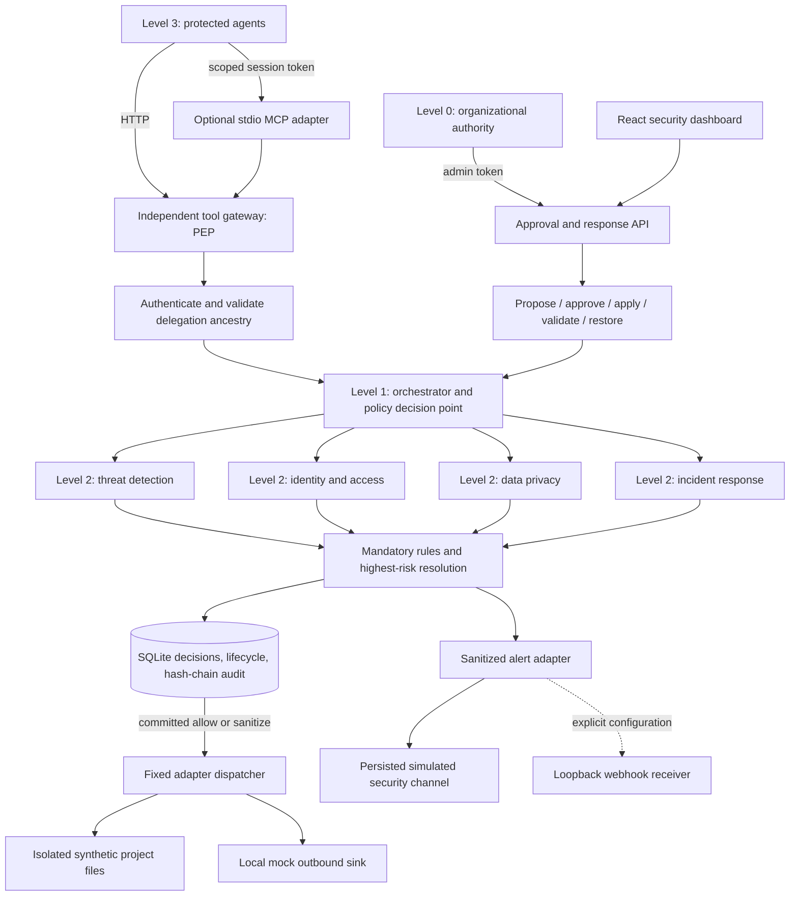
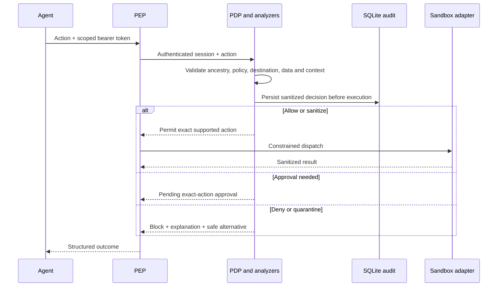

# Architecture and enforcement boundaries

SENTINEL is a local policy service with a fixed tool gateway. The gateway authenticates a session, evaluates independently of the protected agent, commits a sanitized decision, and executes only an authorized sandbox adapter. Security agents are deterministic Python analysis modules; no LLM or hosted model is required.

Allowed actions are committed with `execution_status: pending` before the adapter runs. A final record marks `completed` or `failed`; denied actions are `blocked` and approval requests are `paused`. A pending record after a crash means completion is unconfirmed: the adapter may already have changed a file or the local outbox. Do not retry a pending operation blindly. SQLite and filesystem effects do not form one atomic transaction, and the MVP does not promise exactly-once execution. Storage errors before the committed decision prevent adapter invocation; audit mismatch after a failed anchor advancement stops further execution.

## Components and authority

| Layer | Component | Authority |
| --- | --- | --- |
| 0 | Local organizational authority | Creates sessions, reviews incidents and approvals, authorizes configuration remediation, rollback and restoration. |
| 1 | `Engine` orchestrator / PDP | Resolves evidence under configured policy. Cannot approve its own impactful changes. |
| 2 | Four independent analyzers | Produce structured findings and safe alternatives. Recommendations do not grant permissions. |
| 3 | Protected agent sessions | Use only explicitly assigned capabilities through a short-lived bearer token. A child receives no authority beyond its parent. |
| Boundary | Tool gateway / PEP | Enforces the PDP result and restricts dispatch to implemented sandbox adapters. |

The threat detector looks for instruction override, dangerous command patterns, untrusted instructions and anomalous behavior. Identity/access checks credentials, capability scope and privileged access. Privacy checks classification, PII, sensitive outbound content and destination policy. Incident response recommends containment and constrained recovery. Highest risk wins; mandatory denials remain effective after a numerical score or human review changes.

## Request lifecycle

An approval is tied to one session, one canonical request fingerprint, an expiry and one execution. A different action, another session, a reused approval or a hard policy denial cannot use it. The agent must resubmit the same action with the approved ID. Remediation approvals authorize the proposed synthetic configuration change, not general tool access.

## State and persistence

SQLite stores sessions, structured events, approvals, alerts and remediation history. Tokens are returned on issuance and stored as hashes; snapshots exclude token material. Event payloads are redacted before persistence. A local hash chain detects event alteration; the core's integrity verifier is exposed in the dashboard and API. Audit verification or persistence failure prevents tool execution.

The audit mechanism is tamper evident within its local trust boundary. A party controlling the gateway process, database and local integrity material can rewrite local state. An independent remote audit anchor, immutable store and protected keys are required for a stronger deployment. The MVP makes no claim of forensic immutability.

## Execution scope

| Operation | MVP behavior |
| --- | --- |
| Project file read/write | Confined to the configured synthetic sandbox; paths are canonicalized and escape/symlink attempts denied. Sensitive output is redacted or denied. |
| Network send | Evaluated as an outbound action, then delivered only to a local mock sink when allowed. No real external transmission adapter is provided. |
| Terminal command | Inspected for demonstrations; arbitrary host shell execution is unsupported and denied. |
| Security notification | Default simulated delivery is persisted; explicit loopback webhook configuration permits testing real local HTTP delivery. SIEM structured JSON, Slack text and Teams MessageCard payload formats are selectable without live corporate credentials. |
| MCP | Exposes protected gateway operations to an MCP-capable client. It adds no global host interception. |
| Cursor rules / reusable skill | Advisory integration guidance. Neither changes the host security boundary nor overrides the gateway. |

Native IDE tools, direct filesystem/network calls, installed extensions, and tools that do not route through SENTINEL are outside this PEP. Cursor-specific hook support has not been verified. Host isolation must remove alternative tool paths before this design can constrain a hostile agent across an entire IDE.

## Recovery and extensibility

Recovery follows Detect → Contain → Diagnose → Propose → Human approval → Apply → Validate → Human restore. Synthetic configuration changes retain their original version for rollback. Applying a fix does not itself release a quarantined session. Review records explain false positives and resolutions while preserving mandatory controls.

New executable adapters must constrain resources independently, accept only the exact authorized action, provide bounded responses, and demonstrate that denied actions have no side effects. A future production adapter needs OS-level isolation, robust identity, policy ownership, secure notification egress, durable execution bookkeeping and external audit anchoring. An LLM may add evidence; it must not become the authorization boundary.
