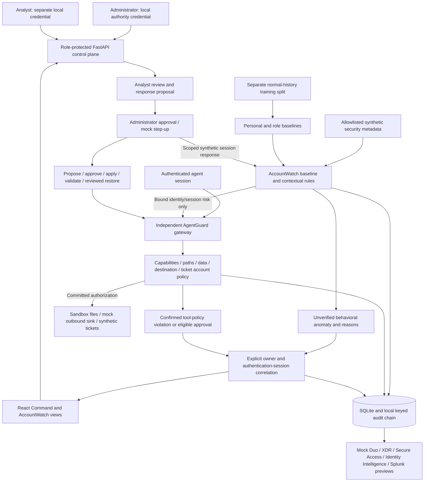
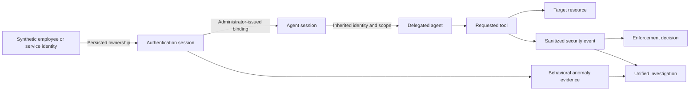

# SENTINEL Enterprise architecture

This enhancement preserves the existing local AgentGuard gateway, four deterministic analyzers, scoped delegation, approvals, remediation, rollback, audit chain and six existing dashboard views. It adds AccountWatch analytics, explicit identity/session ownership, shared investigation views, and local Cisco-oriented connector previews. The video and Activity Lab informed the baseline-band and evidence-review presentation; they are design references, not connected enterprise infrastructure.

## Services and trust boundaries

The Python service boundaries are modules rather than separately deployed microservices. AccountWatch never becomes a tool executor. The existing gateway remains responsible for all supported adapter authorization. No LLM decision is required to preserve the mandatory controls.

## Identity and event data flow

An identity ID and authentication-session ID are bound together when an administrator provisions a linked agent. The authentication session must belong to that identity and tenant. A child inherits the parent's binding and ticket-account scope and cannot expand them. Request bodies cannot assert an agent identity or replace ownership.

Correlation requires those explicit persisted relationships and compatible event times within the configured window. Coinciding timestamps, a shared role, or similar behavior alone do not establish a relationship. The UI labels this an investigation association, not proof that an employee caused an agent action or that an account is compromised.

## Analytics and enforcement remain separate

AccountWatch fits median/MAD volume ranges and contextual frequency evidence from separate normal synthetic history. Ingested observations do not retrain these profiles. Rule reasons identify personal deviations, relevant role context, unfamiliar devices, coarse regions, sensitive volumes, and same-session sequences. A score prioritizes review; it is not a calibrated probability or a disciplinary assessment.

A lone unusual login hour does not automatically contain an account. Corroborated high risk can pause a sensitive operation by the explicitly bound agent for an exact human approval or mock administrator step-up. An approved scoped restriction applies only to the identified synthetic authentication session. Agent capability checks and hard data/destination/account rules still apply after verification or review.

The fifth feature demonstrates this directly: an Acme-bound agent can read `A-104`, while an attempted `N-208` lookup is denied both with a flagged instruction and with a predefined simulated missed-detection label. These detector labels are deliberately simulated, not a measurement of AI recall. Unauthorized ticket metadata and body are not returned.

## API and persistence compatibility

Existing AgentGuard APIs, original A–D scenarios, and local state remain in place. New `/api/accountwatch/*`, `/api/command`, `/api/incidents/correlated`, `/api/integrations` and `/api/enterprise/*` routes use the same control plane. The separate analyst role can inspect and review investigations; administrator-only routes control provisioning, approvals, scoped response application, verification, retention purge, and demonstrations. Protected-agent tokens cannot administer either module.

AccountWatch records use distinct SQLite record kinds. Raw activity audit snapshots are minimized while their current record digests remain integrity checked; retention replaces expired detail records with tombstones. See the [security and privacy guide](accountwatch-security-privacy.md) for the precise retention boundary. The local key/process remain trusted and the single-process store is not independently immutable evidence.

Allowed tool intent is committed before the adapter runs. A pending completion record after a storage failure means that an allowed side effect may already have happened. SQLite and filesystem effects are not one transaction, and blind retries are unsafe. See the [original architecture](architecture.md) for these preserved execution semantics.

## Cisco positioning and deployment limit

Cisco Duo, Cisco XDR, Cisco Secure Access, Cisco Identity Intelligence, and Cisco Splunk appear as proposed domain mappings with mock status. No Cisco logos, live product credentials, official affiliation, certification, support, or verified product integration are claimed. Connector preview data does not leave the local demonstration.

Native IDE commands, arbitrary host tools, direct network access and filesystem access outside the gateway remain outside interception. MCP is an integration mechanism, not a complete host sandbox. This prototype adds no production account disabling, real credential rotation, production policy mutation, SSO, distributed availability, or enterprise-scale model claims.
